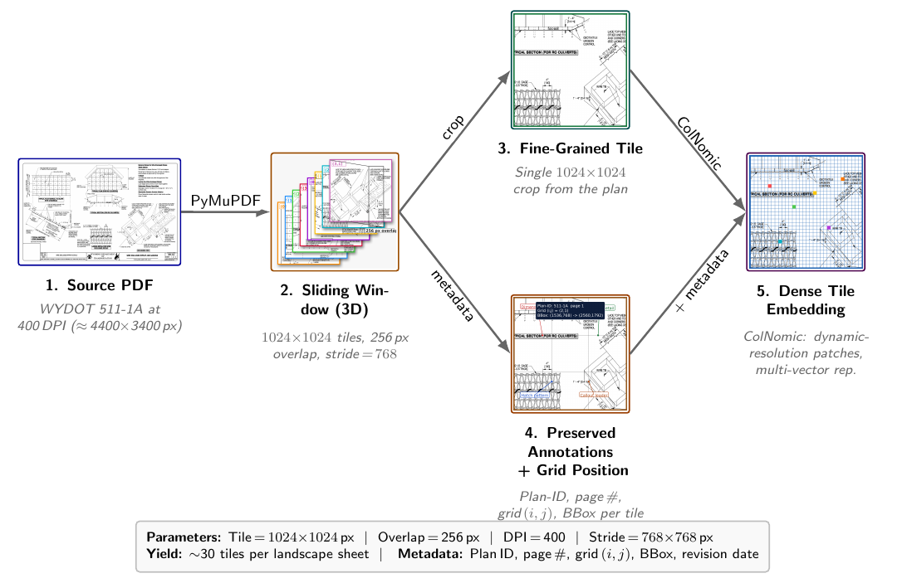
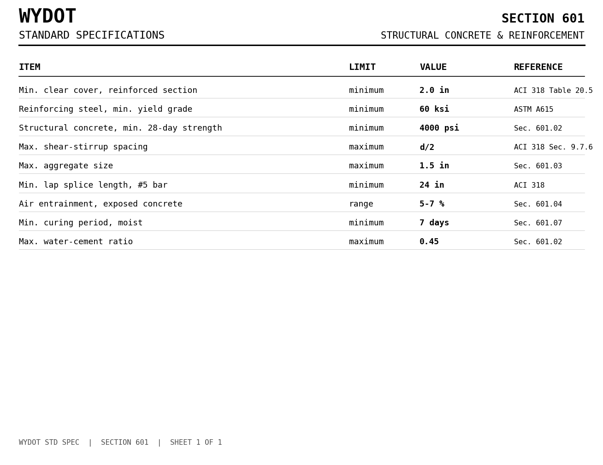

# Supplementary information

Supporting tables for *A Visual-First Multimodal RAG for Retrieval-Assisted
Question Answering and Compliance Checking of Civil Standard Plans*
(submitted to *Automation in Construction*, AUTCON-D-26-04051).

Additional material supporting the article is published here: twelve tables,
figures and notes (S1–S12). Nothing on this page is needed to follow the
argument of the paper. Each item either records implementation provenance, or
gives a breakdown whose headline figures are already stated in the article text,
or illustrates a procedure the article describes in words.

Every number below is reproduced by a script in `code/` and written to
`reports/`. See [`TABLE_PROVENANCE.md`](TABLE_PROVENANCE.md) for the mapping from
each table to its backing report and script.

## Contents

- [Table S1. Implementation provenance for every retrieval run](#table-s1-implementation-provenance-for-every-retrieval-run)
- [Table S2. Benchmark distribution by agency and reasoning category](#table-s2-benchmark-distribution-by-agency-and-reasoning-category)
- [Table S3. Human-curated 78-pair WYDOT anchor set](#table-s3-humancurated-78pair-wydot-anchor-set)
- [Table S4. Retrieval-only latency distribution](#table-s4-retrievalonly-latency-distribution)
- [Table S5. Multi-plan compliance before and after threshold pre-resolution](#table-s5-multiplan-compliance-before-and-after-threshold-preresolution)

- [Figure S6. Sliding-window tiling scheme](#figure-s6-slidingwindow-tiling-scheme)
- [Table S7. Judge accuracy, full-page against tile-level retrieval](#table-s7-judge-accuracy-fullpage-against-tilelevel-retrieval)
- [Table S8. Rank-conditioned end-to-end judge accuracy](#table-s8-rankconditioned-endtoend-judge-accuracy)
- [Table S9. Zero-shot Michigan transfer, joint against Michigan-only pool](#table-s9-zeroshot-michigan-transfer-joint-against-michiganonly-pool)
- [Table S10. Agentic compliance confusion matrix](#table-s10-agentic-compliance-confusion-matrix)
- [Note S11. Complementary retrieval enhancements](#note-s11-complementary-retrieval-enhancements)
- [Figure S12. Standard-Specifications reference sheet](#figure-s12-standardspecifications-reference-sheet)

## Table S1. Implementation provenance for every retrieval run

Implementation provenance for every retrieval run. The generating script is the authoritative record of resolution, chunking, pooling, and query formulation for that run; its module docstring documents them in prose.

| Run | R@5 | OCR engine / model | Generating script |
|---|---|---|---|
| nemotron_colembed_8b | 95.28% | nvidia/nemotron-colembed-vl-8b-v2 | full_benchmark_retrieval.py |
| colnomic_rerank_monoqwen_424 | 94.58% | nomic-ai/colnomic-embed-multimodal-3b | full_benchmark_retrieval.py |
| colnomic_tiling_v2_page_plus_tiles | 93.87% | nomic-ai/colnomic-embed-multimodal-3b | full_benchmark_retrieval.py |
| colnomic_tiling_v2_patch_union | 93.87% | nomic-ai/colnomic-embed-multimodal-3b | full_benchmark_retrieval.py |
| colnomic_tiling_v2_page_plus_tiles_coarse | 93.63% | nomic-ai/colnomic-embed-multimodal-3b | full_benchmark_retrieval.py |
| colnomic_tiling_v2_patch_union_coarse | 93.40% | nomic-ai/colnomic-embed-multimodal-3b | full_benchmark_retrieval.py |
| nemotron_colembed_4b | 92.92% | nvidia/nemotron-colembed-vl-4b-v2 | full_benchmark_retrieval.py |
| colnomic_3b | 92.69% | nomic-ai/colnomic-embed-multimodal-3b | full_benchmark_retrieval.py |
| colnomic_tiling_v2_max_page_tile | 92.69% | nomic-ai/colnomic-embed-multimodal-3b | full_benchmark_retrieval.py |
| colnomic_tiling_full_page_424 | 92.45% | nomic-ai/colnomic-embed-multimodal-3b | full_benchmark_retrieval.py |
| colnomic_tiling_v2_max_page_tile_coarse | 92.45% | nomic-ai/colnomic-embed-multimodal-3b | full_benchmark_retrieval.py |
| colnomic_circularity | 92.45% | nomic-ai/colnomic-embed-multimodal-3b | full_benchmark_retrieval.py |
| colnomic_tiling_v2_blend_coarse | 91.98% | nomic-ai/colnomic-embed-multimodal-3b | full_benchmark_retrieval.py |
| colnomic_7b | 91.27% | nomic-ai/colnomic-embed-multimodal-7b | full_benchmark_retrieval.py |
| colnomic_tiling_v2_blend | 91.27% | nomic-ai/colnomic-embed-multimodal-3b | full_benchmark_retrieval.py |
| colnomic_binary_quantized | 90.33% | nomic-ai/colnomic-embed-multimodal-3b | full_benchmark_retrieval.py |
| colnomic_tiling_v2_published_max_coarse | 90.09% | nomic-ai/colnomic-embed-multimodal-3b | full_benchmark_retrieval.py |
| colqwen25_v0_2 | 87.26% | vidore/colqwen2.5-v0.2 | full_benchmark_retrieval.py |
| colnomic_tiling_v2_top3_sum_coarse | 84.20% | nomic-ai/colnomic-embed-multimodal-3b | full_benchmark_retrieval.py |
| colnomic_tiling_v2_published_max | 83.96% | nomic-ai/colnomic-embed-multimodal-3b | full_benchmark_retrieval.py |
| colnomic_tiling_tile_level_424 | 83.73% | nomic-ai/colnomic-embed-multimodal-3b | full_benchmark_retrieval.py |
| tiling_tile_level_424 | 82.08% | vidore/colpali-v1.2 | -- |
| colnomic_tiling_v2_top3_sum | 81.84% | nomic-ai/colnomic-embed-multimodal-3b | full_benchmark_retrieval.py |
| tiling_full_page_424 | 76.89% | vidore/colpali-v1.2 | -- |
| colpali_v13 | 69.58% | vidore/colpali-v1.3 | full_benchmark_retrieval.py |
| hpc_colpali_bq | 65.09% | vidore/colpali-v1.2 (binary quantized) | full_benchmark_retrieval.py |
| ocr_bm25_meta | 58.02% | Tesseract OCR | bench_ocr_bm25.py |
| ocr_bm25 | 54.72% | Tesseract OCR | bench_ocr_bm25.py |
| visrag_ret | 53.77% | openbmb/VisRAG-Ret | bench_visrag.py |
| bge_m3_ocr_dense_sparse | 50.00% | Tesseract OCR (baselines_v2/ocr_text.json) | bench_bge_m3_tuned.py |
| bge_m3_ocr_tuned | 50.00% | Tesseract OCR (baselines_v2/ocr_text.json) | bench_bge_m3_tuned.py |
| bge_m3_ocr_chunk_maxpool | 46.93% | Tesseract OCR (baselines_v2/ocr_text.json) | bench_bge_m3_tuned.py |
| visionrag_pyramid_fixed | 45.99% | sentence-transformers/all-MiniLM-L6-v2 | bench_visual_fixed.py |
| bge_m3_ocr_chunk_sparse | 44.81% | Tesseract OCR (baselines_v2/ocr_text.json) | bench_bge_m3_tuned.py |
| ocr_minilm_chunked | 40.57% | Tesseract OCR (baselines_v2/ocr_text.json) | bench_text_fixed.py |
| bge_m3_ocr | 36.79% | Tesseract OCR (baselines_v2/ocr_text.json) | bench_bge_m3_tuned.py |
| bge_m3_ocr_full_single | 36.79% | Tesseract OCR (baselines_v2/ocr_text.json) | bench_bge_m3_tuned.py |
| clip_l14_336_tiled | 36.79% | openai/clip-vit-large-patch14-336 | bench_weak_fixed.py |
| bge_m3_ocr_chunk_meanpool | 36.32% | Tesseract OCR (baselines_v2/ocr_text.json) | bench_bge_m3_tuned.py |
| ocr_minilm | 25.24% | Tesseract OCR (baselines_v2/ocr_text.json) | bench_text_fixed.py |
| visionrag_pyramid | 23.11% | VisionRAG (Pyramid, RRF-fused) | bench_visual_fixed.py |
| dse_qwen2_2b | 22.17% | MrLight/dse-qwen2-2b-mrl-v1 | full_benchmark_retrieval.py |
| pix2struct_textcaps_fixed | 16.27% | google/pix2struct-textcaps-base | bench_weak_fixed.py |
| clip_b32_tiled | 13.92% | openai/clip-vit-base-patch32 | bench_weak_fixed.py |
| pix2struct_docvqa_fixed | 9.67% | google/pix2struct-docvqa-base | bench_weak_fixed.py |
| pix2struct_decode_minilm | 7.31% | Tesseract OCR (baselines_v2/ocr_text.json) | bench_weak_fixed.py |
| nougat_base_fixed | 2.36% | facebook/nougat-base | bench_weak_fixed.py |
| clip_b32_whole | 1.89% | openai/clip-vit-base-patch32 | bench_weak_fixed.py |
| clip_vit_b32 | 1.89% | openai/clip-vit-base-patch32 | bench_weak_fixed.py |
| nougat_decode_minilm | 0.47% | Tesseract OCR (baselines_v2/ocr_text.json) | bench_weak_fixed.py |
| layoutlmv3 | 0.00% | microsoft/layoutlmv3-base | bench_weak_fixed.py |
| layoutlmv3_cls | 0.00% | microsoft/layoutlmv3-base | bench_weak_fixed.py |
| layoutlmv3_cls_centered | 0.00% | microsoft/layoutlmv3-base | bench_weak_fixed.py |
| layoutlmv3_meanpool | 0.00% | microsoft/layoutlmv3-base | bench_weak_fixed.py |
| layoutlmv3_meanpool_centered | 0.00% | microsoft/layoutlmv3-base | bench_weak_fixed.py |
| udop_decode_minilm | 0.00% | Tesseract OCR (baselines_v2/ocr_text.json) | bench_weak_fixed.py |
| udop_encoder_meanpool | 0.00% | microsoft/udop-large | bench_weak_fixed.py |
| udop_encoder_meanpool_centered | 0.00% | microsoft/udop-large | bench_weak_fixed.py |

## Table S2. Benchmark distribution by agency and reasoning category

Distribution of the 4,056-pair five-DOT benchmark by agency and reasoning category. The held-out Michigan DOT zero-shot set (93 pairs) is not included in this table.

| Category | WYDOT | Caltrans | AZDOT | ARDOT | FDOT | Total |
|---|---|---|---|---|---|---|
| Visual Interpretation | 201 | 416 | 149 | 85 | 549 | 1,400 |
| Dimensional Accuracy | 170 | 287 | 144 | 87 | 327 | 1,015 |
| Logical Reasoning | 172 | 331 | 104 | 104 | 446 | 1,157 |
| Hallucination Rate | 15 | 192 | 17 | 2 | 258 | 484 |
| Total | 558 | 1,226 | 414 | 278 | 1,580 | 4,056 |

*Note: the agency column shown as ARDOT is Arkansas material. It was recorded as
Colorado DOT (CDOT) in the initial release; the sheets carry Arkansas State Highway
Commission title blocks, and `data/sources.json` documents the correction. The local
collection key remains `colorado_2025` so that the frozen reports stay consistent.*

## Table S3. Human-curated 78-pair WYDOT anchor set

Human-curated 78-pair WYDOT anchor set: per-category Recall@5 and end-to-end judge accuracy with 95% bootstrap CIs (10,000 resamples, seed42). Retrieval is over the 237-page WYDOT-only index; judge accuracy uses the local Qwen2.5-VL-7B answerer with a Qwen2.5-VL-72B judge.

| Category | N | Recall@5 (%) | Judge (%) |
|---|---|---|---|
| Dimensional | 29 | 100.00 [100.0, 100.0] | 79.31 [62.1, 93.1] |
| Visual | 16 | 87.50 [68.8, 100.0] | 68.75 [43.8, 87.5] |
| Logical | 17 | 94.12 [82.4, 100.0] | 94.12 [82.4, 100.0] |
| Hallucination | 16 | 75.00 [50.0, 93.8] | 81.25 [62.5, 100.0] |
| Overall | 78 | 91.03 [84.6, 96.2] | 80.77 [71.8, 89.7] |

## Table S4. Retrieval-only latency distribution

Retrieval-only latency distribution (ms) for full-page ColNomic MaxSim retrieval on the 424-pair page-disjoint test split over the combined 1,898-page five-DOT visual index. Wall-clock time collected with time.perf_counter() on a single NVIDIA H100 80 GB HBM3 (PyTorch 2.5.1, CUDA 12.1; the device is recorded in the released result file), one query at a time (batch size 1).

| Percentile | Full-page (424 queries, 1,898-page index) |
|---|---|
| min | 85.40 |
| p25 | 94.43 |
| p50 | 97.94 |
| p75 | 100.61 |
| p95 | 102.86 |
| p99 | 103.66 |
| max | 151.97 |
| mean | 97.67 |

## Table S5. Multi-plan compliance before and after threshold pre-resolution

Multi-plan compliance verdict accuracy on the n=100 scale set, before and after replacing the textual d/2 threshold in the rules registry with a per-drawing pre-resolved numeric value.

| N plans | Before d/2 fix | After d/2 fix |
|---|---|---|
| N=2 | 25/25 | 25/25 |
| N=3 | 25/25 | 25/25 |
| N=4 | 25/25 | 25/25 |
| N=5 | 13/25 | 25/25 |
| Total | 88/100 (88%) | 100/100 (100%) |

## Figure S6. Sliding-window tiling scheme

Sliding-window tiling used in the companion tiling study. Sheets are rasterized at 400 DPI and cut into overlapping 1024×1024 tiles with 256-pixel overlap, so fine annotations survive at native resolution and retrieval can be scored per tile. The deployed configuration indexes full pages; tiling is evaluated only as an ablation.

## Table S7. Judge accuracy, full-page against tile-level retrieval

Judge accuracy of full-page against tile-level retrieval on the 424-pair test split (N=397 queries whose target page yields at least 15 tiles at 400 DPI, about half the 30 tiles a typical landscape sheet yields, which in practice is nearly all plan pages). Measured on the predecessor ColPali backbone.

| Retrieval granularity | Judge accuracy (%) |
|---|---|
| Full-page (200 DPI) | 64.23 [59.4, 68.8] |
| Tile-level (400 DPI) | 68.77 [64.2, 73.3] |
| Gain (tile - full) | +4.53 pp |

## Table S8. Rank-conditioned end-to-end judge accuracy

End-to-end judge accuracy on the 424-pair test split when the answerer sees only the rank-1 retrieved page, partitioned by whether that page is the gold page. Wilson 95% intervals; Fisher exact p=9.7 10^-12.

| Partition | n | Correct | Judge acc. [95% CI] |
|---|---|---|---|
| Rank-1 hit | 284 | 231 | 81.34% [76.4, 85.4] |
| Rank-1 miss | 140 | 68 | 48.57% [40.4, 56.8] |
| Overall (top-1 answering) | 424 | 299 | 70.52% [66.0, 74.7] |

## Table S9. Zero-shot Michigan transfer, joint against Michigan-only pool

Zero-shot Michigan transfer, joint against Michigan-only candidate pool.

| Candidate pool | # Candidates | R@1 | R@5 |
|---|---|---|---|
| Joint (1,898+298) | 2,196 | 68.82 [58.8, 77.3] | 91.40 [83.9, 95.6] |
| Michigan-only | 298 | 74.19 [64.5, 82.0] | 93.55 [86.6, 97.0] |

## Table S10. Agentic compliance confusion matrix

Agentic compliance confusion matrix over 8 cross-plan verification queries. GT and Pred are the ground-truth and predicted verdicts; Match indicates agreement; Steps is the number of verification steps the Planner produced. Expected minimum decomposition is 2 steps per query.

| ID | Plans | GT | Pred | Match | Steps |
|---|---|---|---|---|---|
| comp_01 | 511-1A, 203-2A | PASS | PASS | yes | 8 |
| comp_02 | 606-7C, 606-2B | PASS | PASS | yes | 7 |
| comp_03 | 511-1A | PASS | PASS | yes | 8 |
| comp_04 | 202-1 | PASS | PASS | yes | 9 |
| comp_05 | 511-1A | PASS | PASS | yes | 10 |
| comp_06 | 606-4B | PASS | PASS | yes | 8 |
| comp_07 | 203-2A | PASS | PASS | yes | 10 |
| comp_08 | 203-2A | PASS | PASS | yes | 9 |

## Note S11. Complementary retrieval enhancements

Two further enhancements are available as drop-in additions and are orthogonal to LoRA: (i) a VLM cross-encoder re-rank, where the Top-k retrieved candidates are each passed to a VLM with a binary “does this plan answer the query?” prompt. This sharpens Recall@1 on visually-similar sheet pairs at a latency cost; and (ii) hybrid BM25 fusion, combining dense MaxSim scores with a sparse BM25 score over plan-ID/sheet-title metadata for queries that target alphanumeric identifiers. Pointwise VLM re-ranking (MonoQwen2-VL-v0.1, 2B parameters) over the Top-20 retrieved candidates adds 5.91 s of latency per query (averaging 295 ms per pointwise candidate pass) on a single NVIDIA H100 GPU, corresponding to a throughput of approximately 610 queries per hour. Both are reported as secondary options; the off-the-shelf, zero-shot retriever (ColNomic-3B) is the primary deployment configuration because it relies on the pretrained embedding space alone without introducing the latency of cross-encoder re-ranking or the metadata dependencies of hybrid search.

## Figure S12. Standard-Specifications reference sheet

A rendered Standard-Specifications reference sheet from the rule-grounding corpus. The seven governing limits for the compliance archetypes (e.g., min. cover 2.0”, max. stirrup spacing d/2) are embedded among distractor rows; the agent must retrieve the correct sheet among 1,913 candidates and extract the governing limit from the table.

